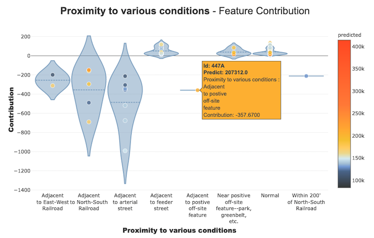
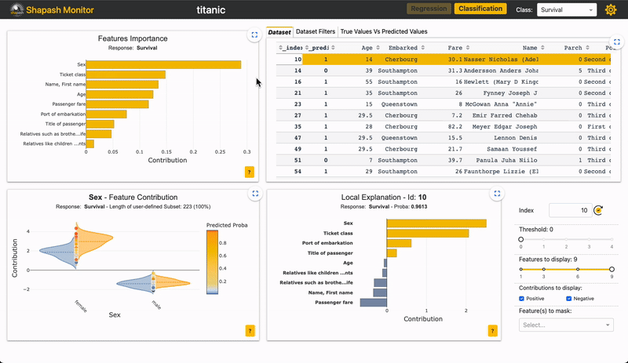
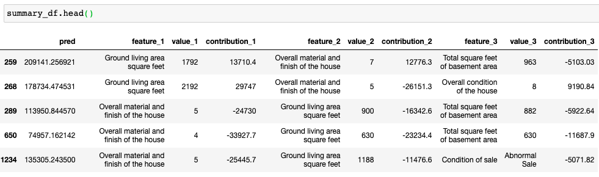
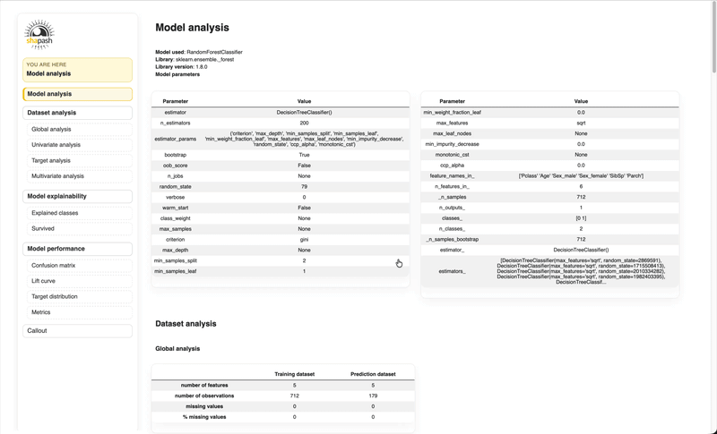

Welcome to the Shapash documentation!
=====================================

**Shapash** is a Python library that makes machine learning models interpretable and understandable
by everyone. Its plots and outputs use explicit labels for features and their values, so data scientists
can understand their models and share the results with people who don't work with data.
Shapash is developed by data scientists at `MAIF <https://www.maif.fr/>`__.

.. table::
   :class: company-table

   +---------------------------------+----------------------------------------------------------+-----------------------------------------+
   | Company                         | GitHub Account                                           | Website                                 |
   +=================================+==========================================================+=========================================+
   | .. image:: ./_static/maif.png   | `MAIF GitHub <https://github.com/MAIF>`__                | `MAIF <https://www.maif.fr/>`__         |
   |    :align: center               |                                                          |                                         |
   |    :width: 60px                 |                                                          |                                         |
   |    :alt: MAIF logo              |                                                          |                                         |
   +---------------------------------+----------------------------------------------------------+-----------------------------------------+

.. grid:: 1 2 2 4
   :gutter: 2

   .. grid-item-card:: Getting started
      :link: overview
      :link-type: doc

      How Shapash works, in a few lines of code.

   .. grid-item-card:: Installation
      :link: installation-instructions/index
      :link-type: doc

      Install Shapash and its optional extras.

   .. grid-item-card:: Tutorials
      :link: tutorials
      :link-type: doc

      Notebooks for every feature.

   .. grid-item-card:: API reference
      :link: autodocs/index
      :link-type: doc

      Classes, methods and parameters.

What Shapash does
-----------------

**Clear, labeled explanations.** Global and local explainability plots display readable feature names
and values instead of technical ones.

**A web app to explore your model.** Navigate from global to local explainability, filter subsets on
explanatory or additional features, and compare correct and wrong predictions.
See the `live demo <https://shapash-demo.ossbymaif.fr/>`__.

**Summarized local explanations.** Keep only the most influential features of each prediction, and
export the summary to a pandas DataFrame:

**Explainability quality metrics.** Evaluate how far you can trust an explanation with three metrics:
stability, consistency and compacity.

**An audit report.** Generate a standalone HTML report that records the data, the model and its
explainability, as a basis for an audit document. See the `example report <report.html>`__.

**From exploration to deployment.** The ``SmartPredictor`` object brings predictions and summarized
explanations to production, through an API or in batch mode.

**Text classifiers (preview).** ``NlpExplainer`` explains text classifiers at the word level, with its
own web app, what-if analysis and label-noise detection.

Compatibility
-------------

- Regression, binary classification and multiclass classification.
- Most scikit-learn, LightGBM, CatBoost and XGBoost models.
- Contributions computed with SHAP or LIME, or provided directly, for example from another
  explainability method.
- Preprocessing with category_encoders, a scikit-learn ``ColumnTransformer``, or a simple dictionary
  of feature names.

Shapash is released under the Apache 2.0 license.

.. toctree::
   :maxdepth: 2
   :hidden:

   overview
   installation-instructions/index
   tutorials
   autodocs/index
