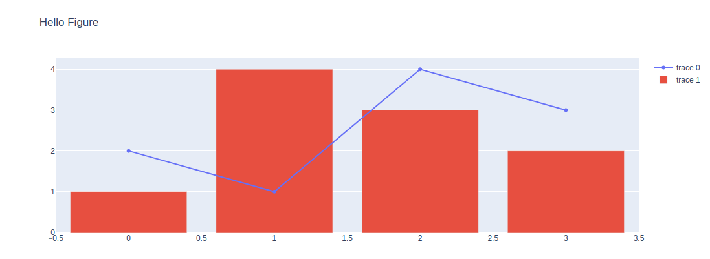

Installation
============

Shapash requires Python 3.11 or newer. Install it with pip:

.. code-block:: bash

    pip install shapash

Optional extras
---------------

Some features need extra dependencies, available as extras:

.. list-table::
   :header-rows: 1
   :widths: 20 80

   * - Extra
     - Use
   * - ``report``
     - Generate the Shapash Report.
   * - ``nlp``
     - Explain text classifiers (preview). Installs PyTorch, Transformers, Captum and related libraries.
   * - ``lime``
     - Use LIME instead of SHAP to compute contributions.
   * - ``xgboost``, ``lightgbm``, ``catboost``
     - Install a version of these libraries that Shapash supports.

For example:

.. code-block:: bash

    pip install "shapash[report]"
    pip install "shapash[report,lime]"

Jupyter
-------

Shapash plots are Plotly figures. They display in JupyterLab, Jupyter Notebook 7 and VS Code without
any extra configuration. To check that Plotly works in your environment:

.. code-block:: python

    import plotly.graph_objects as go

    fig = go.Figure()
    fig.add_trace(go.Scatter(y=[2, 1, 4, 3]))
    fig.add_trace(go.Bar(y=[1, 4, 3, 2]))
    fig.update_layout(title="Hello Figure")
    fig.show()

If the figure doesn't display, see Plotly's
`troubleshooting guide <https://plotly.com/python/troubleshooting/>`__.

Compatibility issues
--------------------

If you get an error from one of the model libraries (XGBoost, LightGBM, CatBoost), install the matching
extra to get a version that Shapash supports, for example:

.. code-block:: bash

    pip install "shapash[xgboost]"
