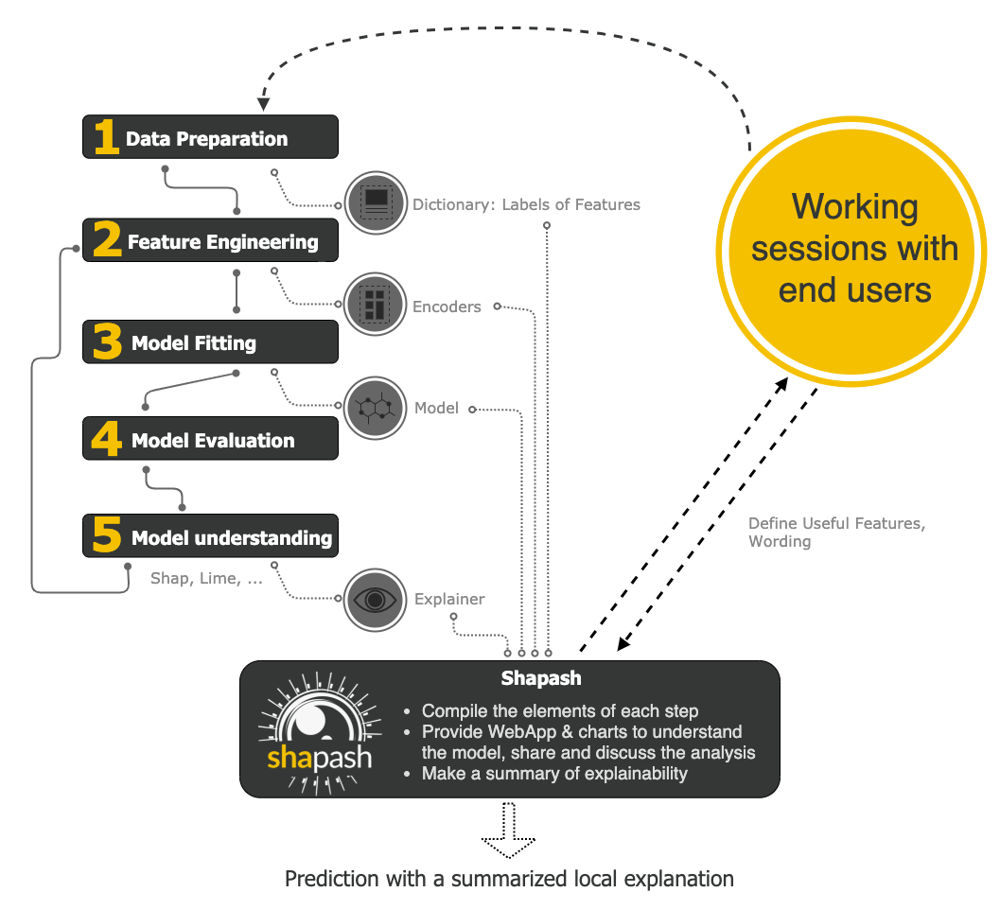

Getting started
===============

How Shapash works
-----------------

Shapash sits on top of explainability libraries: it uses SHAP or LIME as a backend to compute the
contribution of each feature to each prediction. It then uses what you know about the model and its
data (encoders, feature names, labels) to present those contributions in a readable form.

Shapash can compute explanations from a model and a dataset, or display precomputed
contributions without access to the model. Feature names, label names and encoders
help make the outputs more understandable.

Precomputed explanations without a model
----------------------------------------

Use ``SmartExplainer(task="regression")`` or
``SmartExplainer(task="classification", classes=[...])`` without passing a model.
The task is mandatory; it is never inferred from contribution shapes or labels.
For classification, provide at least two unique class labels in the exact order
of the contribution and probability outputs. Labels may be numeric or strings,
but cannot mix the two. ``label_dict`` provides optional display names, not class
ordering. When a model is provided, its metadata remains authoritative: do not
pass ``task`` or ``classes``.

.. code-block:: python

    xpl = SmartExplainer(task="regression")
    xpl.compile(
        x=X_encoded,
        contributions={"contributions": feature_contributions, "base_values": baseline},
        y_pred=predictions,
        y_target=targets,  # optional
    )
    xpl.plot.features_importance()
    xpl.plot.local_plot(index=X_encoded.index[0])
    summary = xpl.to_pandas()

Both ``contributions`` and ``y_pred`` are required on every ``compile`` call.
``x`` must be a nonempty DataFrame with unique row and column labels. Predictions
and optional targets must be one-column pandas objects with the same index as
``x``. Classification predictions and targets must contain declared class labels.
No inference backend is initialized, and no dummy model is needed.

Contribution formats:

- Regression: a DataFrame or numeric array of shape ``(n_samples, n_features)``.
- Classification: a list of matrices in ``classes`` order, or an array of shape
  ``(n_samples, n_features, n_classes)``.
- Binary classification also accepts one matrix for ``classes[1]``; its negative
  is used for ``classes[0]``. Use a list of two matrices when outputs are not
  complementary.

DataFrame contributions must have the correct index and feature order. All
contributions must be finite numeric values. With preprocessing, pass encoded
data and contributions in the corresponding feature space; supported inverse
transforms, aggregation, feature groups and postprocessing remain available.

.. code-block:: python

    xpl = SmartExplainer(
        task="classification",
        classes=["no", "yes"],
        label_dict={"no": "Declined", "yes": "Accepted"},
    )
    xpl.compile(
        x=X_encoded,
        contributions=[contributions_no, contributions_yes],
        y_pred=predicted_labels,
        proba_values=probabilities,  # optional DataFrame, columns ["no", "yes"]
    )
    summary = xpl.to_pandas(proba=True)

Probabilities are optional, but required for probability-based views. Supply one
column per class, in exactly ``classes`` order, with finite values in ``[0, 1]``
and rows summing to one. They can also be supplied later through ``add``.
Shapash does not derive predictions or probabilities from contributions: their
output scale may be a raw score rather than a probability.

For waterfall plots, supply ``base_values`` in the contributions dictionary.
Regression accepts a scalar or one value per row; classification accepts one
value per class or a matrix of shape ``(n_samples, n_classes)``. Pandas baselines
must align with ``x``; classification baseline DataFrame columns must match
``classes``. Baselines must use the same output scale as contributions. Without
them, ordinary bar plots remain available, but waterfall plots raise an explicit
error rather than inventing a baseline.

Plots, filtering, grouped summaries, ``to_pandas``, the WebApp, and
``SmartExplainer.save`` / ``load`` are available for the supplied dataset.
New predictions, stability analysis, interaction computation, model reports and
``to_smartpredictor`` require a model and are explicitly unavailable in this mode.
Omit backend-specific options: contributions are formatted directly, not
computed by SHAP or LIME. This mode does not change existing model-based workflows.

Additional scikit-learn models
----------------------------------------

The following estimators are registered for feature validation and prediction,
including preprocessing with a supported ``ColumnTransformer``:

- Trees: ``DecisionTreeClassifier``, ``DecisionTreeRegressor``,
  ``ExtraTreeClassifier``, ``ExtraTreeRegressor``,
  ``HistGradientBoostingClassifier`` and ``HistGradientBoostingRegressor``.
- Regularized regression: ``Ridge``, ``RidgeCV``, ``Lasso``, ``LassoCV``,
  ``ElasticNet`` and ``ElasticNetCV``.
- Bayesian regression: ``BayesianRidge`` and ``ARDRegression``.
- Robust and quantile regression: ``HuberRegressor``, ``TheilSenRegressor``
  and ``QuantileRegressor``.
- Incremental regression: ``SGDRegressor`` and ``PassiveAggressiveRegressor``.
  The latter is deprecated in scikit-learn 1.8; prefer ``SGDRegressor`` for new models.
- Other linear regression: ``Lars``, ``LarsCV``, ``LassoLars``, ``LassoLarsCV``,
  ``LassoLarsIC``, ``OrthogonalMatchingPursuit`` and ``OrthogonalMatchingPursuitCV``.
- Classification with cross-validation: ``LogisticRegressionCV``.
- Linear support vector machines: ``LinearSVC`` and ``LinearSVR``.
- Linear classifiers: ``RidgeClassifier``, ``RidgeClassifierCV``, ``SGDClassifier``,
  ``Perceptron`` and ``PassiveAggressiveClassifier``. The latter is deprecated in
  scikit-learn 1.8; prefer ``SGDClassifier`` for new models.
- Generalized linear regression: ``PoissonRegressor``, ``GammaRegressor`` and
  ``TweedieRegressor``.
- Other support vector machines: ``NuSVC`` and ``NuSVR``.
- Nearest neighbors: ``KNeighborsClassifier`` and ``KNeighborsRegressor``.
- Neural networks: ``MLPClassifier`` and ``MLPRegressor``.
- Ensembles: ``AdaBoostClassifier``, ``AdaBoostRegressor``, ``BaggingClassifier``,
  ``BaggingRegressor``, ``VotingClassifier``, ``VotingRegressor``,
  ``StackingClassifier`` and ``StackingRegressor``.

These additions cover single-output regression and binary or multiclass
classification. They do not add support for multi-target regression or multilabel
classification. The SHAP backend chooses a specialized explainer when supported
by the installed SHAP version, otherwise a model-agnostic explainer, which may be
slower. In particular, multiclass histogram gradient boosting may use this fallback.

For classifiers without ``predict_proba``, such as ``LinearSVC``, the default SHAP
fallback explains ``decision_function`` scores rather than predicted labels.
``SmartPredictor`` can compute predictions and contributions without probabilities;
calling ``predict_proba()`` explicitly still raises an error. Scores and their
contributions must not be interpreted as probabilities.

The LIME backend requires ``predict_proba`` for classification and ``predict``
for regression. It rejects classifiers without probabilities with an explicit
error when the backend is initialized (during ``compile()`` when using
``backend="lime"``), without switching automatically to SHAP. Use the SHAP backend
when supported, or fit a calibrated classifier exposing probabilities.
For example, LIME requires ``probability=True`` for ``NuSVC``,
``loss="log_loss"`` for ``SGDClassifier``, and ``voting="soft"`` for
``VotingClassifier``. LIME explanations are local approximations, not exact
additive reconstructions of the model output.

For generalized linear regression, the default SHAP backend explains ``predict``:
the contributions plus the base value reconstruct the prediction after the
inverse link function, not the linear predictor. This also applies when supplying
a SHAP background masker or selecting ``algorithm="auto"``. It uses a model-agnostic
explainer even though these estimators expose coefficients.

``VotingClassifier`` requires ``voting="soft"`` and base estimators that support
probabilities. The SHAP backend explicitly rejects hard voting rather than
explaining numerically encoded class labels. For multiclass ``NuSVC`` or ``SVC``
without probabilities, keep ``decision_function_shape="ovr"`` (the default);
pairwise ``"ovo"`` scores are not per-class explanations and are rejected.
Alternatively, fit with ``probability=True`` to explain probabilities.
``StackingClassifier`` can use a final estimator without probabilities when it
provides a per-class ``decision_function``.

Nearest neighbors, neural networks and the additional ensembles generally use
model-agnostic SHAP explanations. Cost grows with the number of input features,
background samples and observations to explain; registration does not imply
TreeExplainer support or the same performance as native tree explanations.

A compiled ``SmartExplainer`` can be exported using ``to_smartpredictor()``,
including when it uses a ``ColumnTransformer``. The exported predictor accepts
the original raw input column names in ``add_input()``, as a DataFrame or a
dictionary. It retains the transformer-prefixed names internally for feature
labels, groups, postprocessing and explanations. DataFrames using those internal
names remain accepted. Columns explicitly dropped by the transformer are optional
in raw input; unknown columns are rejected.

Keras, TensorFlow and PyTorch (tabular)
----------------------------------------

``shapash.model`` provides three inference-only adapters:
``KerasModelAdapter``, ``TensorFlowModelAdapter`` and ``PyTorchModelAdapter``.
Install the framework separately. Importing the adapters does not import these
optional frameworks; the selected framework is loaded when constructing its adapter.
The adapters do not train models and do not require a scikit-learn training wrapper.

For example, for an already-trained binary Keras network with a sigmoid output:

.. code-block:: python

    from shapash import SmartExplainer
    from shapash.model import KerasModelAdapter

    adapter = KerasModelAdapter(
        model,
        n_features=X_encoded.shape[1],
        task="classification",
        classes=[0, 1],
        output="probabilities",
    )
    xpl = SmartExplainer(model=adapter, backend="shap", preprocessing=encoder)
    xpl.compile(x=X_encoded)
    predictor = xpl.to_smartpredictor()
    predictor.add_input(x=X_raw)

Use the same arguments with ``TensorFlowModelAdapter`` or ``PyTorchModelAdapter``:

.. code-block:: python

    from shapash.model import TensorFlowModelAdapter, PyTorchModelAdapter

    tf_adapter = TensorFlowModelAdapter(tf_model, n_features=10, task="regression")
    torch_adapter = PyTorchModelAdapter(
        torch_model,
        n_features=10,
        task="classification",
        classes=[3, 8, 42],
        output="logits",
    )

``n_features`` is the number of encoded input features, not the number before
preprocessing. Inputs must be finite numeric two-dimensional tables, in the
network's feature order; preprocessing missing values is the caller's responsibility.
Input values are converted to float32 before framework inference.

- Regression accepts output shapes ``(n_samples,)`` and ``(n_samples, 1)``.
- Binary classification accepts one output for the second class, or two outputs
  in ``classes`` order. ``threshold`` defaults to 0.5 for the second-class probability.
- Multiclass classification requires one output per class, in ``classes`` order.
  Labels need not be consecutive. For user-supplied ``y_target`` or ``y_pred``,
  existing tabular validation still requires numeric labels.
- Set ``output="logits"`` for unnormalized scores: the adapter applies sigmoid
  for one binary output or softmax for multiple outputs. Probability outputs
  must lie in [0, 1] and sum to one. Multi-target and multilabel outputs are rejected.
- Use ``output_key`` to select one tensor from a dictionary-valued output.
  Multiple inputs, images, token sequences and tuples/lists of outputs are not
  supported by these tabular adapters.

Keras models are called with ``training=False``. The Keras adapter uses Keras 3
operations to convert outputs to NumPy. The TensorFlow adapter accepts tf.keras
models, callable ``tf.Module`` objects and explicit SavedModel signatures. Modules
and signatures must perform deterministic inference themselves. Wrap keyword-only
signatures explicitly, for example:

.. code-block:: python

    signature = loaded.signatures["serving_default"]
    adapter = TensorFlowModelAdapter(
        lambda values: signature(features=values),
        n_features=10,
        task="regression",
        output_key="predictions",
    )

The PyTorch adapter uses the module's parameter device and floating-point dtype,
disables gradients and temporarily enters evaluation mode. It restores each
submodule's training flag, including after a failed inference. Parameterless models
use their first buffer or CPU float32. Do not concurrently train or change the mode
of the same model while explaining it.

Both ``backend="shap"`` and ``backend="lime"`` are supported, including prediction
export and supported preprocessing. For tabular framework adapters, SHAP defaults
to DeepExplainer, with automatic compatibility fallbacks described below.
Model-agnostic explanations remain available explicitly. LIME is a local approximation, not an
exact additive reconstruction.
LIME's internal explainer is rebuilt from its reference data after reloading a
pickled predictor.

Saving a predictor also requires its underlying model to be pickleable. Built-in
Keras models and PyTorch modules are covered by tests. Custom model classes must
be importable and may need framework-specific serialization; SavedModel signatures
and local lambdas are not guaranteed pickleable. For those, reload the model in its
native format and recreate the adapter. Only load pickles from trusted sources.

DeepExplainer and GradientExplainer
~~~~~~~~~~~~~~~~~~~~~~~~~~~~~~~~~~~~~~~~

With the SHAP backend and a tabular framework adapter,
``neural_explainer="auto"`` is the default. It tries DeepExplainer first, then
GradientExplainer if DeepExplainer is incompatible, and finally agnostic SHAP
if neither neural method is compatible. Each fallback emits a warning containing
the reason. Compatibility is checked during both initialization and contribution
computation; the selected method is retained for later calls and predictor reloads.
Other model families retain their existing explainer selection.

Choose ``"deep"``, ``"gradient"`` or ``"agnostic"`` to force a method without
automatic fallback. For example, to configure GradientExplainer sampling explicitly:

.. code-block:: python

    xpl = SmartExplainer(
        model=adapter,
        backend="shap",
        neural_explainer="gradient",
        neural_background=X_encoded.iloc[:100],
        explainer_compute_args={"nsamples": 1000, "rseed": 42},
    )
    xpl.compile(x=X_encoded.iloc[100:110])
    predictor = xpl.to_smartpredictor()

Use ``neural_explainer="deep"`` to construct a real ``shap.DeepExplainer``.
For DeepExplainer, omit the GradientExplainer-specific ``nsamples`` and ``rseed``
arguments. ``explainer_args`` supplies native constructor options and
``explainer_compute_args`` supplies native ``shap_values`` options.
Use an explicit method for method-specific options: arguments are not silently
discarded or translated during fallback. Invalid arguments, invalid inputs and
resource errors propagate rather than triggering fallback.

The background must be a nonempty DataFrame in encoded feature space, with the
same columns and order as the data to explain. If omitted, the data passed to
``compile`` is the background. Choose a representative background: it determines
the base values and affects runtime. Classification explanations target the
adapter's probabilities, including sigmoid/softmax for logits. Binary single-output
contributions are expanded to complementary classes. Regression explains the
single predicted value.

Supported neural paths are PyTorch modules and TensorFlow-backed Keras models.
Keras with a non-TensorFlow backend, arbitrary ``tf.Module`` objects and SavedModel
signatures use agnostic SHAP with warnings in auto mode and are rejected when
a neural method is explicitly requested.
Supported layers and differentiable operations depend on SHAP and the framework
version. Unsupported operations and DeepExplainer additivity failures trigger
the next method in auto mode, but propagate for explicit selections.
Shapash never disables additivity checks automatically.
GradientExplainer is sampled and approximate; increase ``nsamples`` to reduce
sampling error and use ``rseed`` for reproducible calls. Ranked output selection
and variance-return tuples are not supported.

These explainers support production export and reload by rebuilding their gradient
graphs/hooks for the selected method from the saved background. The underlying model must still be
pickleable. PyTorch gradient calls preserve the model's training flags and existing
parameter gradients. Do not concurrently train or explain the same model.

Quick start
-----------

Step 1: declare a SmartExplainer
~~~~~~~~~~~~~~~~~~~~~~~~~~~~~~~~

The model is the only required parameter.

.. code-block:: python

    from shapash import SmartExplainer

    xpl = SmartExplainer(
        model=regressor,
        features_dict=house_dict,  # Optional: readable feature names
        preprocessing=encoder,  # Optional: used to display the original feature values
        postprocessing=postprocess,  # Optional: see the postprocessing tutorial
    )

Step 2: compile the dataset
~~~~~~~~~~~~~~~~~~~~~~~~~~~

The dataset is the only required parameter.

.. code-block:: python

    xpl.compile(
        x=X_test,
        y_pred=y_pred,  # Optional: your own predictions (default: model.predict)
        y_target=y_test,  # Optional: displays true values next to predictions
        additional_data=X_additional,  # Optional: extra features shown in the web app
        additional_features_dict=features_dict_additional,  # Optional: names of the extra features
    )

Step 3: display the results
~~~~~~~~~~~~~~~~~~~~~~~~~~~

Plot the results in a notebook, for example the feature importance:

.. code-block:: python

    xpl.plot.features_importance()

Or launch the web app:

.. code-block:: python

    app = xpl.run_app()

Step 4: generate the Shapash Report
~~~~~~~~~~~~~~~~~~~~~~~~~~~~~~~~~~~

The report is a standalone HTML file. It needs the ``report`` extra (see :doc:`installation-instructions/index`).
A YAML file can customize its sections and blocks.

.. code-block:: python

    xpl.generate_report(
        output_file="path/to/output/report.html",
        x_train=X_train,
        y_train=y_train,
        y_test=y_test,
        yaml_path="path/to/report_config.yml",  # Optional: custom layout
    )

Step 5: deploy with a SmartPredictor
~~~~~~~~~~~~~~~~~~~~~~~~~~~~~~~~~~~~

``SmartPredictor`` is a lighter object than ``SmartExplainer``, made for deployment, with additional
consistency checks on the input data. It computes predictions and detailed or summarized local
explanations, through an API or in batch mode.

.. code-block:: python

    predictor = xpl.to_smartpredictor()
    predictor.save("path/to/predictor.pkl")

Next steps
----------

The :doc:`tutorials` cover each feature in detail, and the :doc:`autodocs/index` documents every
parameter.
